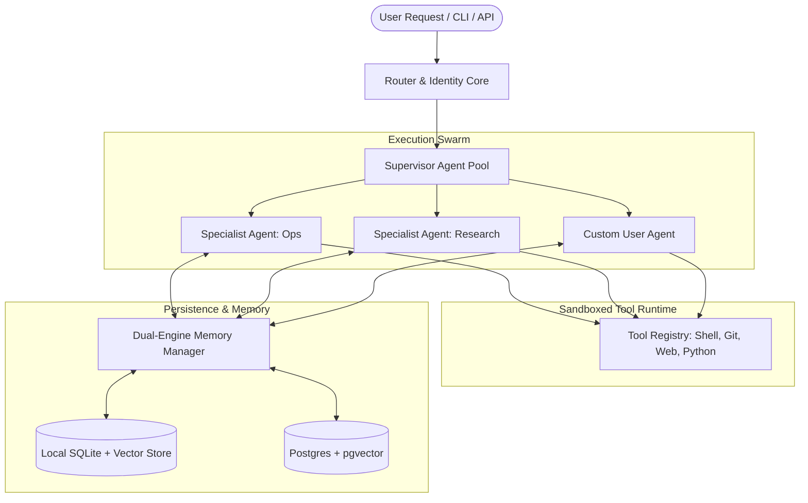

<div align="center">

# ONYX AI
### Autonomous, Self-Improving Personal AI & Specialist Agent Architecture

[](https://github.com/isiraglobal/onyx-ai/releases)
[](https://www.python.org/downloads/)
[](LICENSE)
[](https://github.com/isiraglobal/onyx-ai/generate)
[](deployments/)

<p align="center">
  <b>ONYX</b> is an autonomous personal AI framework engineered to run high-conviction, custom specialist agents locally or in cloud environments with persistent multi-tier memory, deterministic tool-calling, and automated self-improvement loops.
</p>

[Quickstart](#quickstart) • [Custom Agent Guide](#building-custom-agents) • [Architecture](#system-architecture) • [Current Model Release](#current-model-release) • [API & CLI](#cli--interface)

</div>

---

## ⚡ What is ONYX?

ONYX is an open-source agent runtime and blueprint for deploying domain-specific, small, autonomous AI agents. Unlike rigid chatbot wrappers, ONYX decouples **cognition**, **tool sandboxing**, and **long-term contextual recall**, allowing developers to assemble multi-agent swarms tailored to specific operational missions.

### Key Capabilities
- **Local & Hybrid Model Backends**: Out-of-the-box adapters for Ollama, llama.cpp, Hugging Face Transformers, and vLLM.
- **Dual-Engine Long-Term Memory**: Fast SQLite + vector semantic retrieval for local operations, with scalable PostgreSQL + `pgvector` for enterprise clusters.
- **Specialist Agent Swarm**: Role-isolated agent pools supervised by high-conviction orchestrators.
- **Continuous Learning & Ingestion**: Automated multi-format document parser, dataset generation pipelines, and verified benchmark loops.
- **Zero-Trust Tool Execution**: Permissions-gated sandbox covering browser automation, shell execution, filesystem I/O, and git operations.

---

## 🧠 Current Model Release: Onyx (Apex-1 3B)

ONYX ships with the **Apex-1 (3B)** runtime configuration:

| Specification | Details |
| :--- | :--- |
| **Model Name** | **Onyx (Apex-1 3B)** |
| **Base Foundation** | Optimized 3B Parameter Lightweight Dense Transformer (Llama 3.2 lineage) |
| **Context Length** | 8,192 tokens natively supported |
| **Inference Hardware** | Apple Silicon (M-series MPS), NVIDIA CUDA, or CPU fallback |
| **Default Quantization**| 4-bit / Q4_K_M for minimal memory footprint (< 3.2 GB RAM) |
| **Primary Specialty** | Deterministic tool invocation, high-conviction reasoning, structured agent coordination |

---

## 🚀 Quickstart

### 1. Installation

Clone and install dependencies inside a virtual environment:

```bash
git clone https://github.com/isiraglobal/onyx-ai.git
cd onyx-ai

python3 -m venv .venv
source .venv/bin/activate
pip install -e .
```

### 2. Configuration

Create your environment configuration from the template:

```bash
cp .env.example .env
```

### 3. Initialize & Launch

```bash
# Run system pre-checks and database migrations
onyx setup

# Launch the orchestrator and web interface
onyx start
```

Access the native web control interface at `http://127.0.0.1:8080`.

---

## 🛠️ Building Custom Agents

ONYX makes creating small, task-specific agents simple. Subclass `BaseAgent` and declare tools, model preference, and behavior:

```python
from onyx.agents.base import BaseAgent, AgentTask
from onyx.models.registry import ModelRegistry
from onyx.tools.registry import ToolRegistry

class MarketResearcher(BaseAgent):
    name = "market_researcher"
    role_description = "Autonomous quantitative analyst and market scanner"
    system_prompt = (
        "You are an elite quantitative researcher. Analyze data objectively, "
        "cite data sources, and synthesize high-conviction market briefs."
    )
    allowed_tools = ["web_search", "document_reader", "code_exec"]

# Initialize runtime
model = ModelRegistry.get_default_model()
tools = ToolRegistry()
agent = MarketResearcher(model=model, tools=tools)

# Execute task
task = AgentTask(goal="Analyze recent trends in enterprise local AI deployment")
result = await agent.run_task(task)
print(result.result)
```

---

## 🏛️ System Architecture



---

## 💻 CLI & Interface

ONYX includes an ergonomic command-line tool (`onyx`):

```bash
# Check status of local models, backends, and memory store
onyx status

# Execute an autonomous goal directly
onyx agent run "Summarize recent codebase changes and prepare release notes"

# Benchmark model latency and tool-calling accuracy
onyx benchmark --model default
```

---

## 🔍 Search & Engine Optimization (SEO / AEO / GEO)

- **What is ONYX?** An autonomous, self-improving personal AI and multi-agent system designed for local and remote deployment.
- **Can I run ONYX offline?** Yes. ONYX is built natively to interface with local inference engines including Ollama and llama.cpp without external cloud dependencies.
- **How are custom agents deployed?** Custom agents can be defined via clean Python declarative classes or YAML descriptors located under `configs/`.

---

## 📄 License & Community

This project is licensed under the [MIT License](LICENSE). Contributions, custom agent archetypes, and tool modules are welcome via pull requests.
