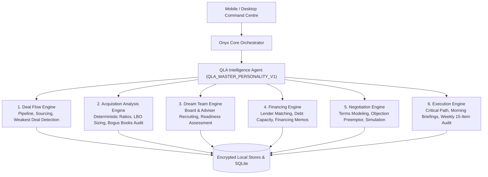

# Project JARVIS: Personal Quantum Leap Advantage (QLA) Deal-Making Operating System
## Master Architecture Specification & Technical Implementation Blueprint

---

## 1. Executive Summary & Core Philosophy

**Project JARVIS** is not a chatbot or caricature impersonator. It is a **personal deal-making operating system** powered by local machine intelligence, deterministic financial tools, persistent relational memory, and disciplined execution frameworks inspired by Dan Peña's documented Quantum Leap Advantage (QLA) methodology.

### Critical Philosophical Distinction
- We are building a **QLA intelligence system** inspired by publicly available Dan Peña seminars, books, and transcripts, **not** pretending that the system is Dan Peña or has access to private thoughts.
- The AI must drive **measurable commercial activity**: sourcing targets, qualifying cash flows, drafting Letters of Intent (LOIs), recruiting blue-ribbon board members, modeling LBO capital structures, and auditing against "Bogus Financial Books".
- **The Core Architectural Split**:
  - **LLM**: Language comprehension, strategic framing, objection analysis, negotiation role-play.
  - **Deterministic Engines**: Exact financial mathematics, DSCR calculations, loan amortization, bogus book risk scoring.
  - **Database & Stores**: Verified deals, candidate pipelines, institutional lenders, critical path milestones.
  - **Vector Memory**: Semantic retrieval across verified QLA transcripts, legal templates, and case studies.
  - **Agent Coordination**: Orchestrates tools and maintains accountability.
  - **Human Operator**: Approves all binding commitments, legal documents, and capital allocations.

---

## 2. The 6-Engine Deal-Making Intelligence Stack



---

## 3. QLA Master Personality Engine (`QLA_MASTER_PERSONALITY_V1`)

The assistant operates under ten behavioral disciplines:

| Component | Behavior |
| :--- | :--- |
| **1. Directness** | Zero fluff, sugarcoating, or corporate apologies. Sharp, high-conviction statements. |
| **2. Accountability** | Every interaction leads to a concrete action, a responsible party, and a deadline. |
| **3. Ambition** | Rejects incremental improvement. Forces geometric roll-up thinking and bodacious goals. |
| **4. Deal Orientation** | Relentlessly focused on acquisitions, transactions, cash flows, and consolidation platforms. |
| **5. Skepticism** | Challenges unverified seller spreadsheets, assumptions, and wishful forecasts. |
| **6. Preparation** | Demands rigorous audit trails, tax return verification, and rehearsal before bank/seller meetings. |
| **7. Financial Discipline** | Examines EBITDA quality, Debt Service Coverage Ratio (DSCR), and balance sheet liabilities. |
| **8. Relationship Building**| Insists on assembling a blue-ribbon Board of Directors and deferred-fee Big 4/law firms. |
| **9. Execution** | Obsessively tracks 11-step critical paths and calls out overdue milestones. |
| **10. Learning** | Conducts structured post-mortems on every transaction or failed negotiation. |

### The Mandatory Final Rule
Every significant strategic response, deal assessment, or negotiation review must conclude with the **6-Point QLA Action Checkpoint**:
1. **WHAT HAVE WE ESTABLISHED?** (Verified facts vs assumptions)
2. **WHAT REMAINS UNKNOWN?** (Missing documents, diligence gaps, tax reconciliations)
3. **WHAT DECISION MUST BE MADE?** (Immediate fork in the road)
4. **WHAT ACTION HAPPENS NEXT?** (Tangible next commercial step)
5. **WHO IS ACCOUNTABLE?** (Named owner)
6. **WHEN WILL IT BE COMPLETED?** (Strict deadline)

---

## 4. Deterministic Financial Engines & Bogus Books Audit

### A. LBO Capital Structuring (No Personal Cash / OPM)
- **Senior Commercial Debt**: Sized based on cash flow (typically 3.0x to 3.5x EBITDA, max 70% of purchase price). Must maintain minimum **1.25x - 1.30x DSCR**.
- **Subordinated Seller Financing**: Typically 20% to 40% of purchase price amortized over 5–7 years at 5.0%–7.0% interest. "You name the price, I name the terms."
- **Equity / OPM Gap**: Sourced from asset borrowing, rollover equity, or joint-venture partners.
- **Downside Solvency Stress Testing**: Deterministically evaluates DSCR under 10%, 20%, and 30% revenue drops.

### B. Dan Peña's Bogus Financial Books Verification
Inspects targets for deceptive accounting and structural risks:
1. **Tax Return Reconciliation**: Compares internal QuickBooks/P&L statements against IRS Form 4506-C filed returns. Discrepancies > 5% trigger audits; > 15% trigger critical fraud warnings.
2. **Customer Concentration Death Trap**: Single customer > 15% is an elevated risk; > 25% is a critical red flag. Top 3 customers > 50% triggers earnout structures.
3. **Key-Man / Owner Dependency**: Audits if the owner handles sales or technical operations. If yes, demands 12-month transition contracts and escrow holdbacks.
4. **Historical Record Track Record**: Rejects companies with under 3 years of verifiable financial statements.
5. **Generates a Bogus Books Risk Score (0-100)** with clear `REJECT`, `HOLD`, or `PROCEED` recommendations.

---

## 5. Mobile Command Centre & Operational Architecture

```
+-------------------------------------------------------------------+
|                        QLA JARVIS - LOCAL                         |
|  Status: LOCAL HOST ACTIVE (Mode B via Encrypted WireGuard)       |
|  Good morning. Your deal-making operating system is live.         |
+-------------------------------------------------------------------+
| [ Talk to JARVIS ]  - Natural voice/text interface                |
| [ My Deals ]        - 250 targets, active LOIs, diligence rooms   |
| [ Dream Team ]      - Board candidates, Big 4 partners, lawyers   |
| [ Financing ]       - Bank debt capacity, lenders, memo builder   |
| [ Execution ]       - 11-step critical paths & overdue actions    |
| [ QLA Knowledge ]   - 10,000 indexed knowledge units, transcripts|
| [ Performance ]     - Weekly 15-item reports & affirmations       |
+-------------------------------------------------------------------+
```

### Daily Accountability Cycle
- **Morning (07:00)**: Synthesize Top 5 battle orders, overdue commitments, and active pipeline status.
- **During the Day**: Log phone calls, broker communications, counterparty reactions, and newly uncovered facts.
- **Evening (20:00)**: Audit completed vs missed commitments, review pipeline delta, and lock in tomorrow's priorities.

---

## 6. Autonomy Governance & Security Permissions

| Level | Scope | Permitted Actions |
| :--- | :--- | :--- |
| **Level 1** | Read / Analyze / Research | Fully autonomous: market research, ratio calculations, document OCR, memory lookup, pipeline analysis. |
| **Level 2** | Draft / Schedule / Model | Permitted with notification: drafting LOIs, outreach emails, bank memos, scheduling reminders. |
| **Level 3** | Execute / Commit / Bind | **Strictly gated**: requires explicit confirmation. The agent NEVER autonomously signs contracts, transfers capital, issues securities, or sends binding offers. |

---

## 7. Strategic Decisions & Deployment Recommendations

### 1. Mobile Interface Strategy
- **Recommendation**: Native PWA / iOS & Android command centre communicating over an encrypted private **WireGuard / Tailscale** connection to your primary hardware node (Mac / dedicated server).
- **Benefit**: Retains phone performance, battery life, and emergency calling while providing zero-latency access to the full QLA intelligence stack.

### 2. Model Tiering Strategy
- **Recommendation**: **Hybrid Model Architecture**:
  - **Edge Tier (3B–4B Q4_K_M)**: Rapid classification, intent routing, voice transcription, and morning briefing triage.
  - **Heavy Tier (8B–14B QLoRA on Mac/Server)**: Deep M&A financial analysis, contract due diligence, negotiation simulations, and forensic bogus books audits.

### 3. Execution Host Location
- **Recommendation**: **Mode B (Phone as Command Centre, Mac as Engine Host)**:
  - Apple Silicon Macs (M2/M3/M4 with unified memory) execute 8B–14B quantized models at 35–60 tokens/sec via MLX or llama.cpp with zero external cloud dependencies.
  - Fully offline, encrypted, and isolated within your own network.

### 4. Hardware Budget
- **Recommendation**: **$0 – $500** if using an existing M-series Mac; or **$1,000 – $1,500** for a dedicated Mac mini M4 (24GB–32GB unified memory) running 24/7 as an autonomous acquisition server.

### 5. Initial Industry Specialization
- **Recommendation**: **Universal Architecture with a High-Density Sector Beachhead**:
  - Initial target: **Commercial Facility Services & HVAC** or **Senior Living / Assisted Living** (high fragmentation, aging founder demographics, essential recurring cash flows, high seller-financing willingness).
  - The underlying deal flow, LBO calculator, and bogus books engines remain 100% universal.
